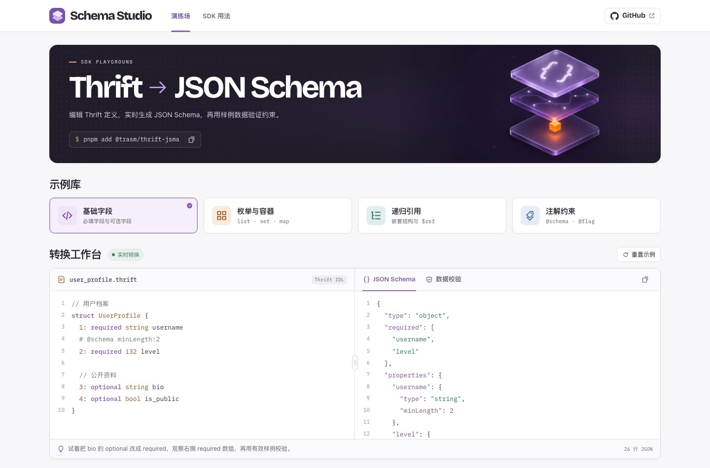

# Thrift to JSON Schema

Convert Thrift structs to JSON Schema or a TypeBox schema in TypeScript.

Explore fields, collections and enums, recursive references, and annotation constraints in [Schema Studio](https://cjinhuo.github.io/thrift-to-json-schema/). Edit any Thrift example to see the generated JSON Schema, then try valid and invalid JSON payloads against it.



## Install

```sh
pnpm add @trasm/thrift-jsma
```

## Usage

```js
import { parseThriftToJsonSchema, parseThriftToTypeBox } from '@trasm/thrift-jsma'

const thrift = `
  # @flag header
  struct User {
    1: string name
    # @schema maxLength:66
    2: optional string email
  }
`

const json = parseThriftToJsonSchema(thrift) // JSON text
const schema = parseThriftToTypeBox(thrift) // TypeBox schema object
```

Use `@flag header` to choose the root struct when the input contains several definitions. A field comment such as `@schema maxLength:66` adds a JSON Schema constraint to that field.

The legacy `@schema` syntax evaluates JavaScript expressions. Use trusted Thrift input with this parser.

## Development

Use Node.js **24.22.2** and pnpm **12.21.0**. The workspace uses Nx to build the two SDK packages and the React editor in dependency order.

```sh
nvm install
nvm use
npm install --global --allow-scripts=pnpm pnpm@12.21.0
pnpm install --frozen-lockfile
pnpm web:dev
```

| Command                            | Result                                                                                               |
| ---------------------------------- | ---------------------------------------------------------------------------------------------------- |
| `pnpm build`                       | Build both SDKs and the demo. GitHub Pages serves the root `dist/` directory.                        |
| `pnpm web:dev`                     | Start the editor with live updates from SDK source.                                                  |
| `pnpm lint` / `pnpm typecheck`     | Check formatting, lint rules and TypeScript.                                                         |
| `pnpm test` / `pnpm test:coverage` | Run the parser and shared Vitest suites.                                                             |
| `pnpm test:packages`               | Pack the built SDKs, install them in a temporary project and check runtime and type imports.         |
| `pnpm test:e2e`                    | Test the development editor, the production Pages build and the standalone bundle in three browsers. |
| `pnpm test:release`                | Rehearse stable and beta releases with a temporary Git remote and local npm registry.                |
| `pnpm verify`                      | Run all checks and builds.                                                                           |
| `pnpm clean`                       | Remove generated build and test outputs.                                                             |

Install the Playwright browsers before the first full verification.

```sh
pnpm --filter @trasm/e2e exec playwright install chromium firefox webkit
pnpm verify
```

The converter uses [thrift-parser](https://github.com/creditkarma/thrift-parser) and [TypeBox](https://github.com/sinclairzx81/typebox). The workspace tooling comes from [mono-sdk-boilerplate](https://github.com/cjinhuo/mono-sdk-boilerplate/tree/c8f10a336ca9b190ec21529c3dbc882a505726c0).
